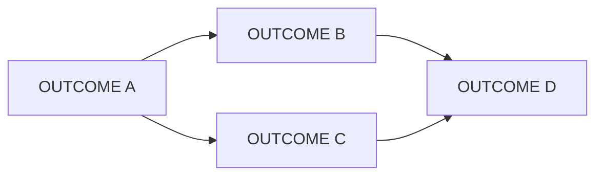

# Phase <N>: <name>

<!-- The current phase, at a glance (P19, P19b,
practices/tracking.md). Goal and order only: no status, health, dates or
progress, which the board owns. Changes only when the goal or scope changes
(practices/planning.md, "Two files per phase"). Plain words: nodes name
outcomes, not package IDs. Replaced when the phase ends, after its outcomes
move to the roadmap and docs. Budget: practices/record-keeping.md. -->

**Goal:** <what the user can see or do when this phase ends>
**Board:** <link to the project's board, Phase view; left out in a public repository>
**Scope:** [phase plan](plans/phase-<N>.md)

Status, priority and who acts next live on the board.

## Order

<!-- The order of outcomes, without status colours. Keep under ~15 nodes;
group small items. Package order itself lives in issue dependencies on the
board. -->

